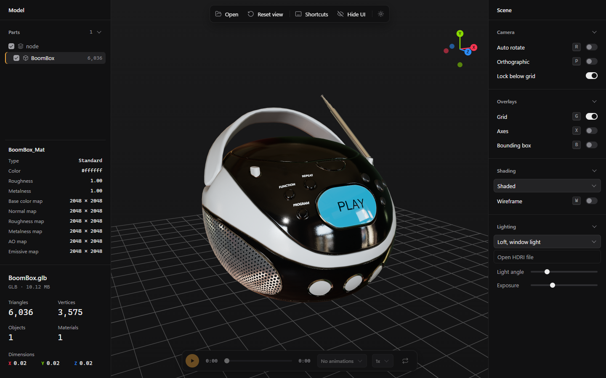

# Asset Viewer

A lightweight 3D model viewer that runs locally. Drop in a GLB, GLTF, FBX, OBJ, STL, PLY or 3MF file and inspect it. Nothing is uploaded and there are no accounts.



## Features

- Drag and drop loading for files or whole folders, plus an Open button
- GLB, GLTF, FBX, OBJ, STL, PLY and 3MF support, including Draco, meshopt and KTX2 compressed GLBs
- External `.bin`, `.mtl` and texture files are picked up from the dropped set
- One asset per session: loading a new model replaces the current one
- Animation playback for GLB / FBX clips, with scrubber, speed and loop
- Shading modes: shaded, clay, normals, UV checker and vertex colors
- Parts tree with per-mesh triangle counts and show/hide, plus a material and texture readout
- Mesh stats: objects, materials, vertices, faces, triangles, dimensions and file size
- HDRI lighting with built-in presets and custom upload, light angle and exposure controls
- Bounding box and axes overlays (axis lines on the ground)
- Navigation gizmo in the top right corner, as in Blender: click an axis to look along it
- Cameras stored in glTF files can be selected
- Orbit controls (right mouse button or shift + left drag pans) with auto rotate and bottom lock, and an orthographic / perspective switch
- Wireframe, grid, light/dark theme and PNG screenshot (up to 4x resolution, with or without background)
- Open from the command line or Explorer's "Open with"
- Dark mode by default, with settings remembered between launches
- Works offline, since three.js is bundled and there is no CDN

## Download

Grab the latest build from the [releases page](../../releases). No Python required.

## Run from source

The app is moving from a Python shell (PyQt5 + Flask) to [Tauri](https://tauri.app). Both run the same page in `web/` for now; the Python shell will be removed once the Tauri one is confirmed to do everything it did.

### Tauri (Windows 10/11)

Requires [Rust](https://rustup.rs), the Visual Studio C++ Build Tools and Node.js. The page runs in the system's WebView2, which comes with Windows 11.

```bash
npm install
npm run dev
```

Arguments for the app go after three `--`, and paths must be absolute because the app is started from `src-tauri/`. The `samples/` folder has a few tiny models to try it with, for example `npm run dev -- -- -- D:/code/asset-viewer/samples/cube.glb --debug`. The built exe takes them directly: `asset-viewer.exe [model.glb] [--debug]`.

- Pass a model path to open it on startup. Neighbouring `.bin`, `.mtl` and texture files in the same folder are loaded with it.
- `--debug` opens the dev tools and exposes `window.viewer` (scene, camera, renderer, controls) in the console.

### Python (old shell)

Requires Python 3 on Windows. It runs on QtWebEngine's Chromium 83.

```bash
pip install -r requirements.txt
python main.py [model.glb] [--debug]
```

Here `--debug` opens the Chromium dev tools port instead, so you can inspect the app at http://localhost:9222.

### HDRIs

HDRI files are not committed. The presets are 2k `.hdr` files from [Poly Haven](https://polyhaven.com/hdris) (CC0): `studio_small_09`, `brown_photostudio_02`, `photo_studio_loft_hall`, `empty_warehouse_01`, `kloofendal_overcast_puresky` and `venice_sunset`, saved in `hdri/` as for example `studio_small_09_2k.hdr` (the names match the Lighting dropdown in `web/index.html`). Without them, built-in room lighting is used.

### Tests

```bash
cargo test --manifest-path src-tauri/Cargo.toml   # Tauri shell
pip install -r requirements-dev.txt               # Python shell
python -m pytest
```

## Keyboard shortcuts

| Key | Action |
| --- | --- |
| `W` | Toggle wireframe |
| `G` | Toggle grid |
| `R` | Toggle auto rotate |
| `P` | Toggle orthographic / perspective |
| `B` | Toggle bounding box |
| `X` | Toggle axes |
| `F` | Reset view |
| `S` | Save screenshot |
| `O` | Open file |
| `T` | Toggle light/dark theme |
| `H` | Hide / show interface |

## Build the exe

```bash
npm run build
```

This builds `src-tauri/target/release/asset-viewer.exe` (the page is embedded in it) and an installer in `src-tauri/target/release/bundle/nsis/`. The installer puts the `hdri/` folder next to the exe and sets up file associations for the model types (it adds the app to "Open with"; the default app the user chose for each type stays).

The old Python build still works:

```bash
pyinstaller --noconfirm --onedir --windowed --name "asset-viewer" --add-data "web;web" --add-data "hdri;hdri" main.py
```

## How it works

The Tauri shell (`src-tauri/`) embeds the page from `web/` in the exe and shows it in a WebView2 window. A small `av` protocol (`protocol.rs`, reached by the page at `http://av.localhost`) hands out only the HDRIs and any model passed on the command line. Everything else happens in the page: dropped files are read locally and parsed by three.js, and nothing leaves your machine. `web/static/shell.js` is the only script that knows which shell it runs in.

Under the Python shell, `main.py` starts a small Flask server (`server.py`) that serves the same things, and shows it in a PyQt5 window. Its Chromium is version 83, so while that shell is still around there is no CSS `gap` on flexbox and no `:has()`. Keep that in mind when editing the CSS.

The light angle slider turns the lighting around the model. The bundled three.js version can't rotate an HDRI, so the app keeps a 1024 px wide copy of it and shifts the image sideways; the key light is aimed from the brightest part of the HDRI and turns with it. The orthographic switch is the same perspective camera with a 1 degree field of view, moved far back.

When you drop a file:

1. `dragdrop.js` collects the files, including the contents of dropped folders.
2. `loader.js` parses the model and resolves its `.bin` / `.mtl` / textures by file name from the same drop.
3. The old model is disposed. The new one is scaled so its longest side is 4 units and placed on the grid.
4. The stats, parts tree and animations are filled in.

## Project structure

```
src-tauri/
  src/main.rs           Tauri window, --debug, registers the av protocol
  src/startup.rs        finds the sidecar files for a model given on the command line (with tests)
  src/protocol.rs       av protocol: /hdri/*, /startup-files (with tests)
  tauri.conf.json       window, bundle, file associations, bundled hdri/ folder
  capabilities/         what the page may ask of the window (theme, title)
main.py                 old shell: Qt window, picks a port, finds the sidecar files
server.py               old shell: Flask routes for the page, /hdri/*, /startup-files
samples/                tiny test models (cube.glb with animation and a camera, pyramid.stl, triangle.ply, tetra.3mf)
tests/                  pytest tests for the Python shell
web/index.html          the whole page; the JS looks up elements by the ids in here
web/static/
  shell.js              which shell the page runs in: where startup files and HDRIs come from, title bar theme
  viewer.js             entry point, imports everything and runs the render loop
  scene.js              scene, camera, renderer, lights, grid, HDRI loading and rotation
  controls.js           orbit controls and their limits
  loader.js             loads a model, scales and centers it
  stats.js              the model spec in the left panel (format, counts, dimensions)
  viewmodes.js          shading modes, done by swapping materials
  outliner.js           the parts tree on the left and the material readout
  animation.js          animation clip picker, scrubber, speed, loop, play/pause
  helpers.js            bounding box and axes overlays, the navigation gizmo
  toast.js              status messages and the loading bar
  ui.js                 the view buttons and sliders (wireframe, grid, theme, light angle, projection, screenshot...)
  shortcuts.js          keyboard shortcuts and tooltips
  dragdrop.js           drag and drop, the Open button, the command line file
  settings.js           remembers the settings between launches
  style.css             all styling (neutral graphite docks, one amber accent, dark/light via body class)
  vendor/three/         three.js (r150) and the loaders/addons used
```

See [CHANGELOG.md](CHANGELOG.md) for what changed between versions.

## Making changes

- **New shortcut or toggle:** add the button in `index.html`, wire up its click in `ui.js`, and add the key to the `shortcuts` object in `shortcuts.js`.
- **New shading mode:** add an `<option>` in `index.html` and a material to the `overrides` object in `viewmodes.js`.
- **New HDRI preset:** add an `<option>` in `index.html` whose value is the file name in `hdri/`.
- **New file format:** add its loader in `loader.js`, and add the extension to `MODEL_EXTENSIONS` in `dragdrop.js`, `src-tauri/src/startup.rs` and `main.py`, and to `fileAssociations` in `tauri.conf.json`.
- **New saved setting:** add it to `saveSettings()` in `settings.js`, and restore it further down in the same file.

## Tech stack

- [three.js](https://threejs.org) for 3D rendering
- [Tauri](https://tauri.app) 2 as the desktop wrapper (WebView2)
- Old shell: [Flask](https://flask.palletsprojects.com), [PyQt5](https://riverbankcomputing.com/software/pyqt/) with QtWebEngine, [PyInstaller](https://pyinstaller.org)

## License

Released under the [MIT License](LICENSE). three.js is also MIT licensed, and its license is in `web/static/vendor/three/LICENSE`.
