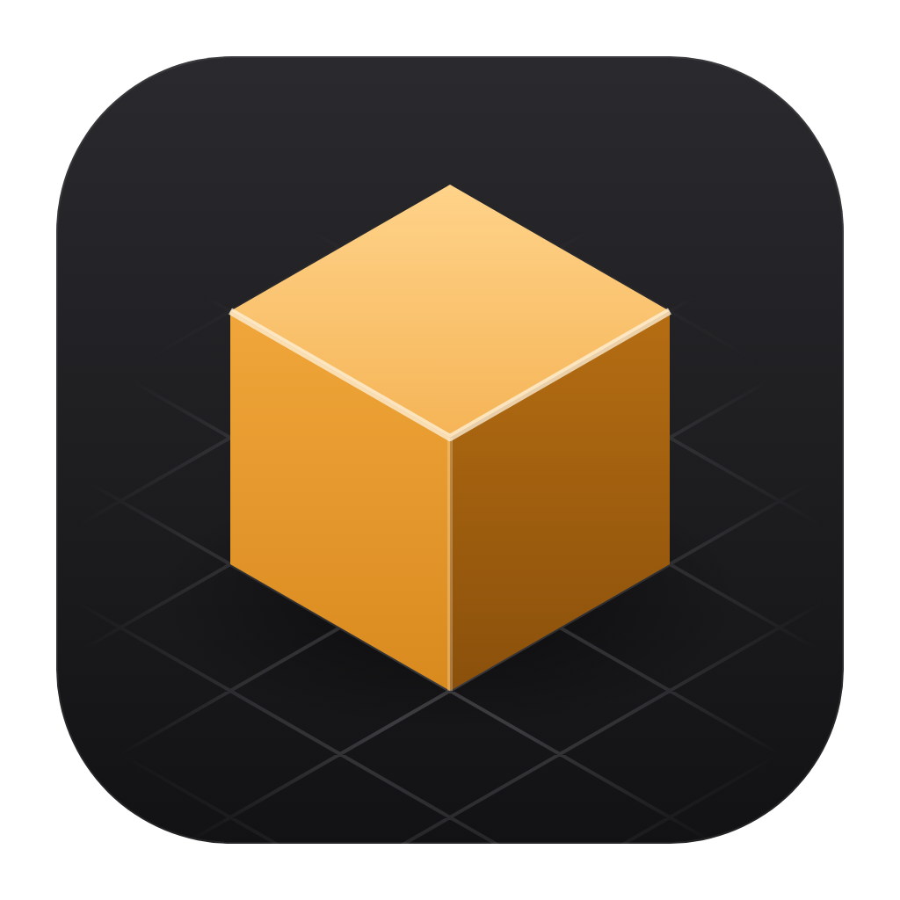

<p align="center">
  
</p>

<h1 align="center">Asset Viewer</h1>

<p align="center">
  A fast, offline 3D model viewer for Windows.<br>
  Open a GLB, glTF, FBX, OBJ, STL, PLY or 3MF file and inspect it: no accounts, no uploads, no setup.
</p>

<p align="center">
  <a href="LICENSE"></a>
  
</p>


Asset Viewer is for 3D artists and developers who need to check a model quickly without opening a full 3D package. It shows how the model is built and what it's made of, and lets you look at it under proper lighting.

## Features

- **Open models quickly:** drag in a model or its whole folder, use the Open button, or pick Asset Viewer in Explorer's "Open with". Textures, `.bin` and `.mtl` files are matched up by name.
- **Inspect the model:** a parts tree with triangle counts and visibility toggles, per-part materials and texture sizes, and the model's original dimensions.
- **Look from every side:** orbit, pan and zoom, an orthographic view, a Blender-style axis gizmo, and the cameras stored in glTF files.
- **Light it properly:** six HDRI presets or your own `.hdr`, with light angle and exposure.
- **Debug views:** clay, normals, UV checker and vertex colors, plus wireframe, bounding box, axes and grid.
- **Animations:** plays GLB and FBX clips with a scrubber, speed and loop.
- **Private and offline:** files are read on your machine and never leave it.
- **Remembers your setup:** dark or light theme, lighting, shading and overlays stay as you left them.

## Supported formats

| Format | Extensions | What's loaded |
| --- | --- | --- |
| glTF | `.glb`, `.gltf` | Materials, textures, animations and cameras. Draco, meshopt and KTX2 compressed files too |
| FBX | `.fbx` | Materials, textures and animations |
| OBJ | `.obj` | Geometry, with materials from its `.mtl` |
| STL | `.stl` | ASCII and binary |
| PLY | `.ply` | Geometry and vertex colors |
| 3MF | `.3mf` | Geometry, colors and materials |

Textures can be PNG, JPEG, WebP or BMP, and KTX2 in glTF files. Models that use separate files (a `.gltf` with its `.bin`, an `.obj` with its `.mtl`, external textures) need those files too: drop the whole folder, select them together, or open the model from Explorer, which brings along the textures and data files in its folder. One model is open at a time; opening another replaces it.

## Install

Download the installer from the [Releases page](https://github.com/kaydee001/asset-viewer/releases) and run it. It works on Windows 10 and 11, and installs Microsoft's WebView2 runtime if it's missing.

The installer adds Asset Viewer to "Open with" for every supported file type, without changing your default apps.

## Usage

Drop a model or a folder onto the window, press `O` to open one, or start it from the command line:

```
asset-viewer.exe path\to\model.glb
```

Drag with the left mouse button to rotate, with the right button (or Shift + left) to pan, and scroll to zoom. Press `?` in the app for all keyboard shortcuts; the main ones are:

| Key | Action | Key | Action |
| --- | --- | --- | --- |
| `F` | Reset the view | `G` | Grid |
| `W` | Wireframe | `B` | Bounding box |
| `P` | Orthographic / perspective | `X` | Axes |
| `R` | Auto rotate | `T` | Light / dark theme |
| `Space` | Play / pause animation | `H` | Hide the interface |

## Development

Built with [three.js](https://threejs.org) inside a [Tauri 2](https://tauri.app) shell. You'll need [Rust](https://rustup.rs), the Visual Studio C++ Build Tools and [Node.js](https://nodejs.org).

```bash
npm install
npm run dev      # run from source
npm run build    # build the exe and the installer
```

See [CONTRIBUTING.md](CONTRIBUTING.md) for the HDRI files, tests, how the app works and the project structure.

## License

[MIT](LICENSE). three.js is MIT licensed, and the HDRI presets are CC0 from [Poly Haven](https://polyhaven.com). The interface icons are in the style of [Lucide](https://lucide.dev) (ISC). The model in the screenshot is BoomBox from the [Khronos glTF Sample Assets](https://github.com/KhronosGroup/glTF-Sample-Assets) (CC0).
