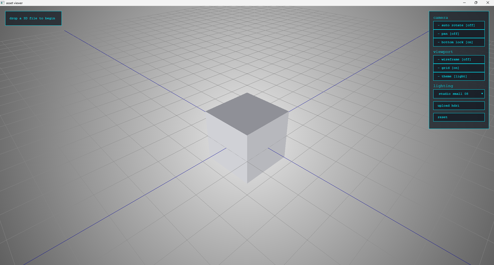

# asset-viewer

A lightweight 3D model viewer that runs locally.
Drop in a GLB, FBX, or OBJ and inspect it — no uploads, no accounts, no nonsense.



## features

- drag and drop model loading (GLB, GLTF, FBX, OBJ), files or whole folders, plus an open-file button
- external .bin / .mtl / texture files resolved from the dropped set, Draco and meshopt compressed GLBs
- drop several models at once and switch between them from a list
- animation playback for GLB / FBX clips
- mesh stats — objects, vertices, faces, triangles, dimensions, file size
- HDRI lighting with built-in presets + custom upload
- orbit controls with auto-rotate, pan, bottom lock
- wireframe toggle, grid toggle, light/dark theme, png screenshot
- shortcuts: `W` wireframe, `G` grid, `R` auto rotate, `F` reset view, `S` screenshot
- works offline — three.js is bundled, no CDN
- PyQt5 desktop app — runs as a standalone exe

## stack

- Three.js — 3D rendering
- Flask — local server
- PyQt5 + QWebEngine — desktop wrapper
- PyInstaller — exe packaging

## download

Grab the latest release from the [releases page](../../releases) — no Python required.

HDRI files are not committed. Put `.hdr` files named `hdri_1.hdr` ... `hdri_5.hdr` in an `hdri/` folder; without them a built-in room lighting is used.

## run locally

```bash
pip install -r requirements.txt
python main.py
```

## build exe

```bash
pyinstaller --noconfirm --onedir --windowed --name "asset-viewer" --add-data "templates;templates" --add-data "static;static" --add-data "hdri;hdri" main.py
```

exe will be in `dist/asset-viewer/`.